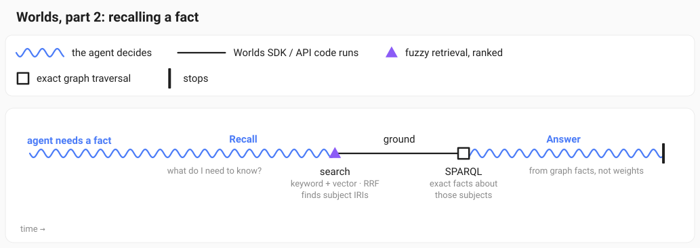

<p align="center">
  <a href="https://docs.wazoo.dev">
    
  </a>
  <br /><br />
  <em>Persistent, edge-native knowledge graph storage for agents.</em>
  <br /><br />
  <a href="https://jsr.io/@worlds/sdk"></a>
  <a href="https://jsr.io/@worlds/sdk/score"></a>
  <a href="https://github.com/wazootech/worlds-sdk-ts"></a>
  <a href="https://deepwiki.com/wazootech/worlds-sdk-ts"></a>
</p>

- **Portable facade** — Unified `WorldsSdk` API that works across in-memory and
  LibSQL/Turso backends.
- **Search** — Hybrid retrieval combining keyword FTS5 and vector embeddings.
- **Query** — The zero-dependency Wazoo SPARQL engine as the opinionated minimal
  default.
- **In-memory RDF/JS** — Zero-setup, zero-dependency graph store and search (the
  engine's `MemoryStore`) for dev, tests, and demos.

## Install

### Package managers

```sh
# Deno (first-class JSR support)
deno add jsr:@worlds/sdk

# Bun / npm / pnpm / Yarn (via JSR npm compatibility layer)
npx jsr add @worlds/sdk
```

See [docs/runtime-compatibility.md](docs/runtime-compatibility.md) for what is
verified on Node.js, Bun, and Deno, and the known limitations.

### CDN (browser / no build step)

[esm.sh](https://esm.sh) serves JSR packages as ES modules — no install, no
bundler needed.

```js
import { WorldsSdk } from "https://esm.sh/jsr/@worlds/sdk@0.5.0";
```

With an import map:

```html
<script type="importmap">
  {
    "imports": {
      "@worlds/sdk": "https://esm.sh/jsr/@worlds/sdk@0.5.0"
    }
  }
</script>
<script type="module">
  import { WorldsSdk } from "@worlds/sdk";
</script>
```

Pin to an exact build for deterministic caching:

```js
import { WorldsSdk } from "https://esm.sh/jsr/@worlds/sdk@0.5.0?pin=v1724100000";
```

## Quickstart

```typescript
import { WorldsSdk } from "@worlds/sdk";
import { MemoryStore, WazooSparqlEngine } from "@wazoo/sparql-engine";
import { RdfjsQuadStore, RdfjsSearchIndex } from "@worlds/sdk/rdfjs";

const store = new MemoryStore();
const client = new WorldsSdk({
  quadStore: new RdfjsQuadStore({ store }),
  searchIndex: new RdfjsSearchIndex(store),
  sparqlEngine: new WazooSparqlEngine({ store }),
});

await client.import({
  source: {
    kind: "serialized",
    contentType: "text/turtle",
    data: `@prefix ex: <http://example.org/> .
      ex:Alice ex:bio "Alice explores the depths." ;
               ex:location "Underdark" .`,
  },
});

const searchResults = await client.search({ query: "explores" });
const subject = searchResults.results[0].subject;

const sparqlResponse = await client.sparql({
  query: `SELECT ?property ?object WHERE { <${subject}> ?property ?object }`,
});
console.log(sparqlResponse);
```

> [!TIP]
> For production search and scale, use the durable LibSQL backend
> (`@worlds/libsql`). The Deno KV backend (`@worlds/denokv`) is
> [archived](https://github.com/wazootech/worlds-denokv); use `@worlds/libsql`
> instead.

## How a fact moves through a world




Time runs left to right. The stroke shows who is acting: the agent (wave), SDK
or API code (solid), an operator (dashed), or nothing at all while the fact sits
in the world (dotted). Red marks steps that cannot be undone: world IDs are
immutable, token secrets are shown once, and Worlds keeps no history of deleted
triples yet. A commit skips triples the world already holds. Durable backends
such as [`@worlds/libsql`](https://github.com/wazootech/worlds-libsql) index new
triples on commit and roll the commit back if indexing fails; indexing can also
be deferred and run later with `reindex()`. Retrieval takes two hops: fuzzy
search finds subject IRIs, then SPARQL fetches the exact facts about them.

The diagrams are generated from
[`worlds-write.feynman.json`](docs/diagrams/worlds-write.feynman.json) and
[`worlds-read.feynman.json`](docs/diagrams/worlds-read.feynman.json) with the
[`feynman-diagram`](https://github.com/EthanThatOneKid/feynman-diagram) skill.

## Core concepts

**Quad store**: Manages RDF triples (subject, predicate, object, graph) with
transactional import and export.

**Search index**: Hybrid retrieval over graph literals, combining keyword FTS5
with vector similarity via an embedding service and quad chunker.

**SPARQL engine**: Evaluates declarative queries and updates against the graph
for structured traversal and reasoning, powered by the zero-dependency
[`@wazoo/sparql-engine`](https://jsr.io/@wazoo/sparql-engine).

## Module layout

`WorldsSdk` is the portable facade. Shared modules sit under `src/client/`:

| Export                      | Role                                                 |
| --------------------------- | ---------------------------------------------------- |
| `@worlds/sdk`               | Root barrel: `WorldsSdk`, interfaces, patch types    |
| `@worlds/sdk/quad-store`    | Quad import/export API, RDF formats, patch buffering |
| `@worlds/sdk/search-index`  | Search index interface and types                     |
| `@worlds/sdk/sparql-engine` | SPARQL engine interface                              |
| `@worlds/sdk/rdfjs`         | In-memory `RdfjsQuadStore` and `RdfjsSearchIndex`    |
| `@worlds/sdk/ai-sdk`        | Vercel AI SDK tool bindings                          |

The SPARQL engine is the external
[`@wazoo/sparql-engine`](https://jsr.io/@wazoo/sparql-engine) package, which
implements `SparqlEngineInterface`.

For architecture documentation (package topology, runtime
model), see [ARCHITECTURE.md](ARCHITECTURE.md). For agent coding rules and
conventions, see [AGENTS.md](AGENTS.md).

## Adapters

This package provides the core in-memory RDF/JS backend. Durable backends live
in separate packages:

| Package                                                                                                            | Persistence                | Search                           | Status                                                                                               |
| ------------------------------------------------------------------------------------------------------------------ | -------------------------- | -------------------------------- | ---------------------------------------------------------------------------------------------------- |
| `@worlds/sdk` (this package)                                                                                       | In-memory (`MemoryStore`)  | RDF/JS keyword                   | Core client + in-memory backend                                                                      |
| [`@worlds/libsql`](https://jsr.io/@worlds/libsql) ([repo](https://github.com/wazootech/worlds-libsql))             | SQLite / Turso Cloud       | Hybrid FTS5 + vector             | **Available** — full SDK factory (`createLibsqlWorldsSdk`)                                           |
| [`@worlds/sqlite`](https://jsr.io/@worlds/sqlite) ([repo](https://github.com/wazootech/worlds-sqlite))             | Local file (`node:sqlite`) | Hybrid FTS5 + sqlite-vec         | **Available** — full SDK factory (`createSqliteWorldsSdk`); SQLite-family `sql-core` source of truth |
| [`@worlds/postgres`](https://jsr.io/@worlds/postgres) ([repo](https://github.com/wazootech/worlds-postgres))       | PostgreSQL + pgvector      | Hybrid tsvector + pgvector       | **Available** — full SDK factory (`createPostgresWorldsSdk`)                                         |
| [`@worlds/cloudflare`](https://jsr.io/@worlds/cloudflare) ([repo](https://github.com/wazootech/worlds-cloudflare)) | D1 (miniflare)             | FTS5 keyword (Vectorize planned) | **Available** — full SDK factory (`createCloudflareWorldsSdk`)                                       |
| [`@worlds/indexeddb`](https://jsr.io/@worlds/indexeddb) ([repo](https://github.com/wazootech/worlds-indexeddb))    | Browser IndexedDB          | JS hybrid TF-IDF + cosine        | **Available** — full SDK factory (`createIndexeddbWorldsSdk`)                                        |

**Backend maturity:** All five durable backends now ship full SDK factories and
parity-green CI suites. Each assembles a quad store, hybrid search index, and
SPARQL engine through the standard `create*WorldsSdk` factory. The Deno KV
backend (`@worlds/denokv`) is
[archived](https://github.com/wazootech/worlds-denokv); use `@worlds/libsql`.

**Choosing persistence:** LibSQL is the default for hybrid FTS/vector search and
faster cold quad index preload at scale. See
[discussion #69](https://github.com/wazootech/worlds-sdk-ts/discussions/69) for
benchmark methodology.

### In-memory (dev, tests, demos)

```typescript
import { WorldsSdk } from "@worlds/sdk";
import { MemoryStore, WazooSparqlEngine } from "@wazoo/sparql-engine";
import { RdfjsQuadStore, RdfjsSearchIndex } from "@worlds/sdk/rdfjs";

const store = new MemoryStore();
const client = new WorldsSdk({
  quadStore: new RdfjsQuadStore({ store }),
  searchIndex: new RdfjsSearchIndex(store),
  sparqlEngine: new WazooSparqlEngine({ store }),
});
```

## Examples

| Example                          | Description                         | Command                                           |
| -------------------------------- | ----------------------------------- | ------------------------------------------------- |
| Hello world                      | In-memory graph with search         | `bun run example:hello-world`                     |
| AI SDK                           | Vercel AI SDK tools with Gemini     | `bun run example:ai-sdk-hello-world`              |
| TF.js Universal Sentence Encoder | Offline TF.js USE embedding service | `bun run example:tfjs-universal-sentence-encoder` |

For LibSQL examples, see the
[`@worlds/libsql`](https://github.com/wazootech/worlds-libsql) repository.

Agent evaluation and memory benchmarking lives in the separate
[wazoo-memorybench](https://github.com/wazootech/wazoo-memorybench) repository,
successor to the archived worlds-client-evals eval harness.

## Agent skills

The [onboarding skill](skills/worlds-sdk-ts-onboarding/SKILL.md) walks new
contributors through the codebase in a pair-programming style — environment
setup, running examples, understanding the client architecture, and
troubleshooting common gotchas. It is not a README in disguise: it enforces an
opinionated sequence (verify before proceeding, run tests before claiming done)
that catches the "it works on my machine" class of onboarding failures.

The skill adopts a named persona (Ethan, the lead developer) and validates each
stage before moving on — Bun version, dependency install, model file presence,
example execution, full test suite. If anything fails, it cross-references the
[TROUBLESHOOTING.md](skills/worlds-sdk-ts-onboarding/TROUBLESHOOTING.md) instead
of guessing.

```bash
# Load the skill in your agent workspace
cp -r skills/worlds-sdk-ts-onboarding .agents/skills/
```

Ask your coding assistant: _"Load the onboarding skill and guide me through the
Worlds client."_

## Advanced

**Agent integration**: search-then-SPARQL two-hop pattern for LLM tool use with
hybrid retrieval. See [AGENTS.md](AGENTS.md) and
[ARCHITECTURE.md](ARCHITECTURE.md).

**LibSQL benchmarks**: Quad index performance methodology, regression policy,
and comparison tables live in the
[`@worlds/libsql`](https://github.com/wazootech/worlds-libsql) adapter repo.

## Development workflow

All CI checks must pass before merging updates.

| Command         | Description                             |
| --------------- | --------------------------------------- |
| `bun run fmt`   | Format all code with `bun fmt`.         |
| `bun run lint`  | Run static analysis (Oxlint).           |
| `bun run check` | Type-check with `bun check`.            |
| `bun run test`  | Execute the test suite with `bun test`. |
| `bun run ci`    | Run complete CI pipeline sequentially.  |

Development uses the latest [Bun](https://bun.com) 1.x, at least 1.4.5 (`bun install` first). The package
is still authored for JSR and consumed from Deno, Node.js and Bun alike.

## Releases

Every push to `main` runs the [Publish workflow](.github/workflows/publish.yml),
which publishes only when `jsr.json`'s `version` is not yet on JSR:

- **Release PR** (bumps `version`): merging it publishes the new version of
  `@worlds/sdk`.
- **Routine PR** (no bump): the Publish job skips green with a notice. That is
  expected, not a failure.

To release, bump `version` in `jsr.json` (minor for additive public API, patch
for fixes) in the PR that should ship. The `jsr` CLI (pinned in `devDependencies`) publishes; `package.json` and
`jsr.json` must agree on exports and dependency ranges, which
`bun run check:manifests` enforces in CI.

## Quicklinks

- [Documentation](https://docs.wazoo.dev)
- [Wazoo Technologies](https://wazoo.dev)
- [Support](https://github.com/wazootech/worlds-sdk-ts/issues)

Developed with [**@wazootech**](https://github.com/wazootech)
